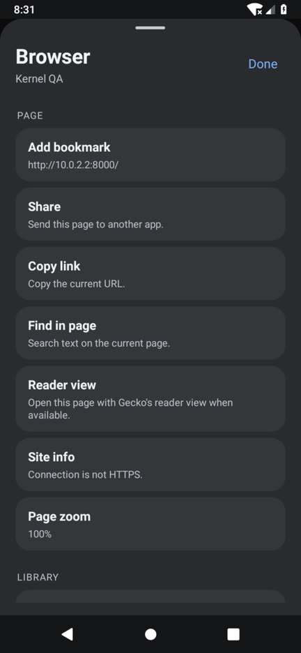
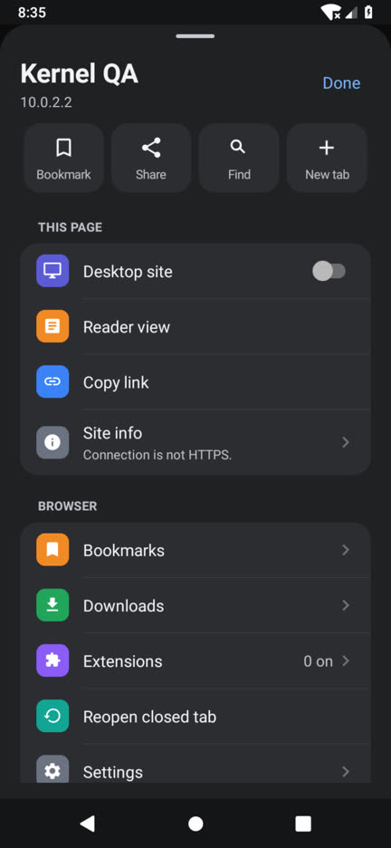
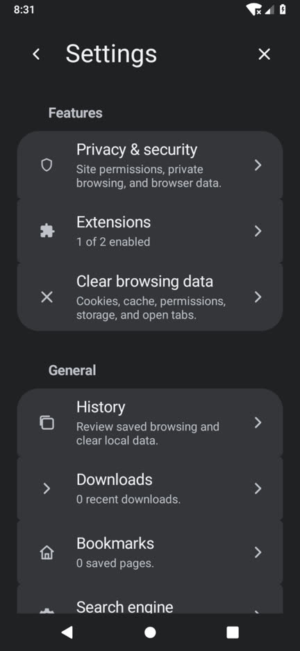
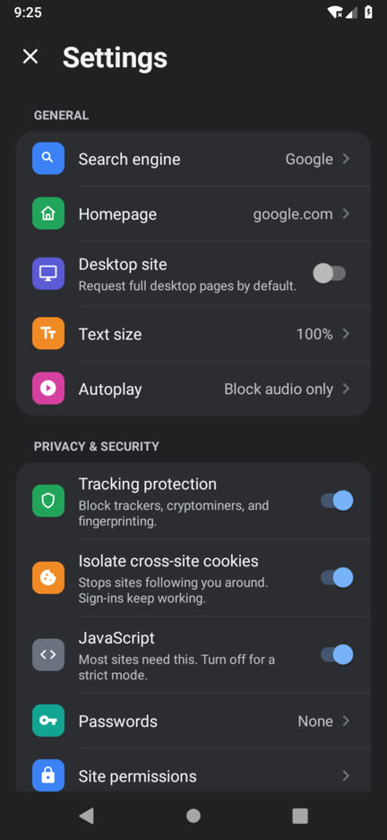
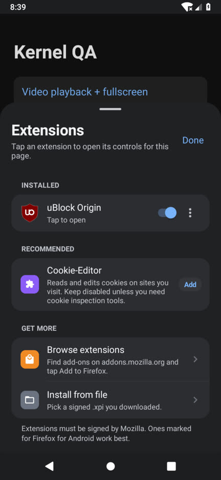
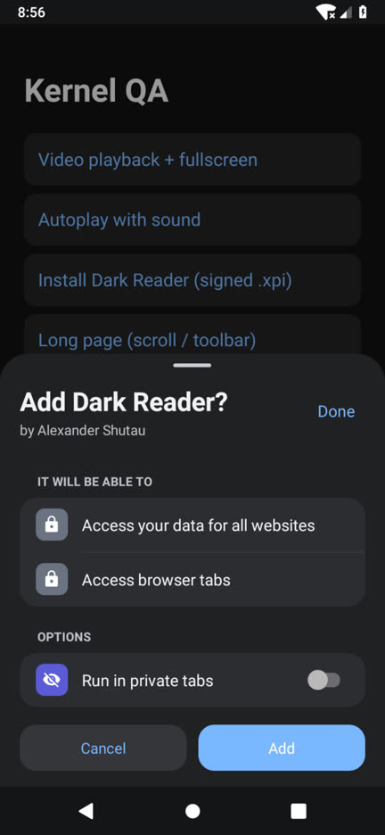
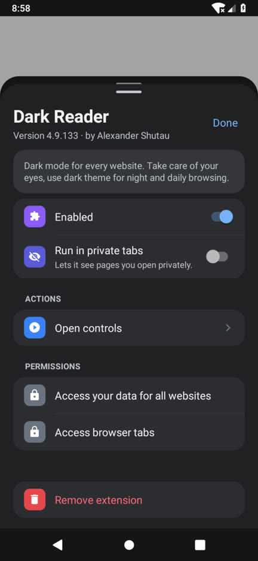
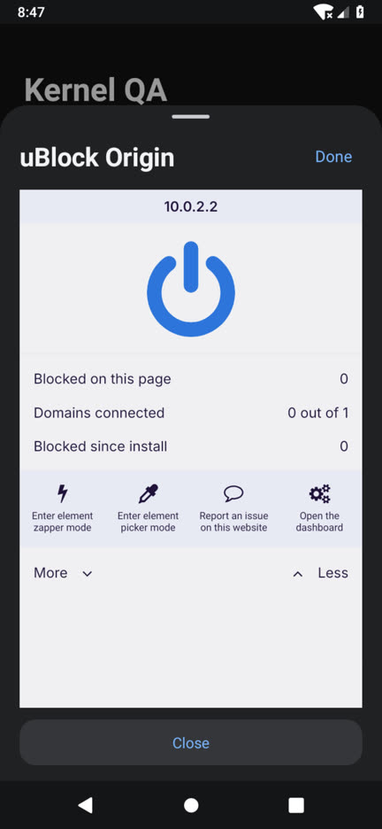
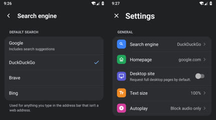
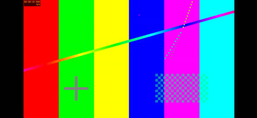

# QA Report: v1.11

Tested on an Android 9 (API 28) x86_64 emulator with software rendering (no KVM/GPU),
1080x2340 at 300 dpi, using the debug and minified release APKs.

The emulator had no trusted route to the public internet, so pages, video, and the extension
install were served from a local test server (`http://10.0.2.2:8000`) using a real,
Mozilla-signed Dark Reader 4.9.133 XPI (SHA-256 checked against AMO).

## Results

| Area | Check | Result |
|---|---|---|
| Build | `testDebugUnitTest` (25 tests) | Pass |
| Build | `assembleDebug`, `assembleRelease` (R8) | Pass |
| Extensions | Bundled uBlock Origin loads at startup | Pass (was **broken** in v1.10, see below) |
| Extensions | uBlock popup opens from the Extensions sheet | Pass (was **broken** in v1.10) |
| Extensions | uBlock "Open the dashboard" opens a new tab | Pass |
| Extensions | Tap a signed `.xpi` link: install prompt, Add, installed | Pass |
| Extensions | Installed extension opens its welcome tab | Pass |
| Extensions | Details page: toggle, private toggle, permissions, remove | Pass |
| Extensions | Removed extension stays removed after restart | Pass |
| Settings | Sub-page navigation and back | Pass |
| Settings | Values refresh when you return (search engine) | Pass |
| Video | H.264 playback in page | Pass (1280x720) |
| Video | Fullscreen hides toolbar and system bars, rotates landscape | Pass |
| Video | Back exits fullscreen and restores portrait and toolbar | Pass |
| Video | Screen stays on while playing (`FLAG_KEEP_SCREEN_ON`) | Pass |
| Video | Audible autoplay blocked silently by default (no dialog) | Pass |
| Layout | Toolbar width after rotating back from landscape | Pass (fixed during QA) |
| Release | Minified release APK: launch, extensions, popup | Pass |

Codec probe on the emulator: MSE yes, H.264 yes, AV1 yes, VP9 **no**. This emulator has no
VP9 decoder. Real phones generally have hardware VP9, and YouTube uses VP9 or AV1 for
1440p/4K.

## Bugs found in v1.10 and fixed

1. **Bundled extensions never loaded.** AGP's default `ignoreAssetsPattern` drops `_*`
   directories, so `_locales/` was stripped from uBlock Origin and Cookie-Editor and Gecko
   rejected them ("Extension is invalid"). Fixed in `app/build.gradle.kts`.
2. **Extension popups never opened.** The app never told GeckoView which tab was active
   (`WebExtensionController.setTabActive`), so browser-action clicks had no target.
3. **Downloads always failed on Android 8/9.** `WRITE_EXTERNAL_STORAGE` was declared but
   never requested at runtime. The app now asks, and falls back to the app's own Downloads
   folder if you decline.
4. **`.xpi` links were downloaded instead of installed.**
5. **Enter on a hardware keyboard didn't submit the address bar.**
6. **Toolbar kept its landscape width after rotating back** (and was off-center in landscape).
7. **Fullscreen video kept the toolbar on screen**, since there was no `onFullScreen` handling.
8. **Every autoplay attempt popped a permission dialog.**

## Not covered here

- **Real YouTube / 4K / AMO.** The sandbox only reaches the internet through a TLS-inspecting
  proxy, and trusting its CA inside the emulator browser was not allowed. Please test these
  on a phone (see the checklist below).
- **Touch scrolling (toolbar hide on scroll).** The software-emulated input pipeline turned
  every swipe into a long-press. That logic is unchanged apart from removing the 4-second
  idle timer.
- **DRM (Widevine)** needs a real device.

## On-device checklist

1. Settings → Extensions → Browse extensions → pick an Android extension → **Add to Firefox**.
   The Kernel install prompt should appear.
2. Open `m.youtube.com`, play a video, tap fullscreen. It should rotate and the toolbar should
   be hidden. Back should exit fullscreen.
3. With **Desktop site** on, play a 4K video and check the quality menu offers 2160p
   (requires a phone with VP9/AV1 hardware decoding).
4. Download any file. It should appear in Downloads, including on Android 9.

## Screenshots

| Before | After |
|---|---|
|  |  |
|  |  |

| Extensions | Install prompt | Details | uBlock popup |
|---|---|---|---|
|  |  |  |  |

